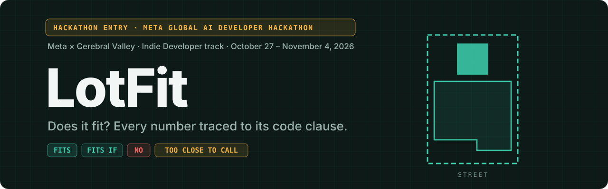
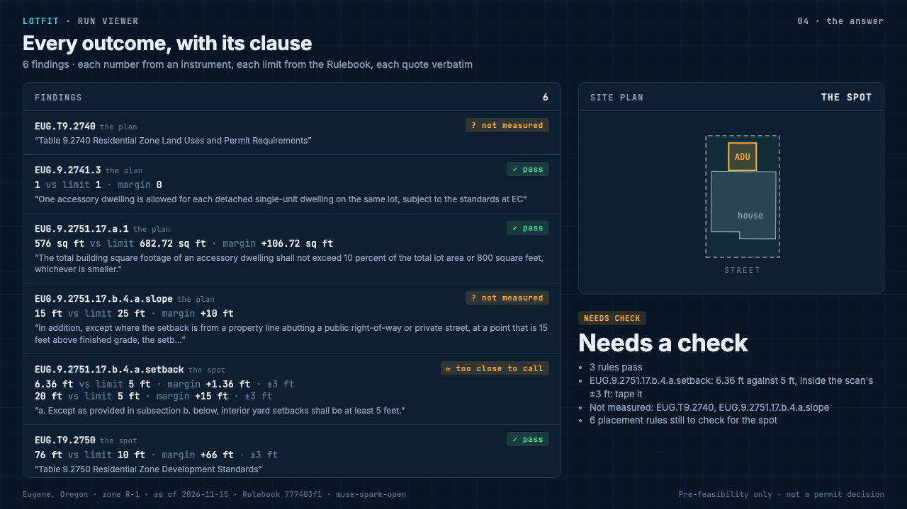
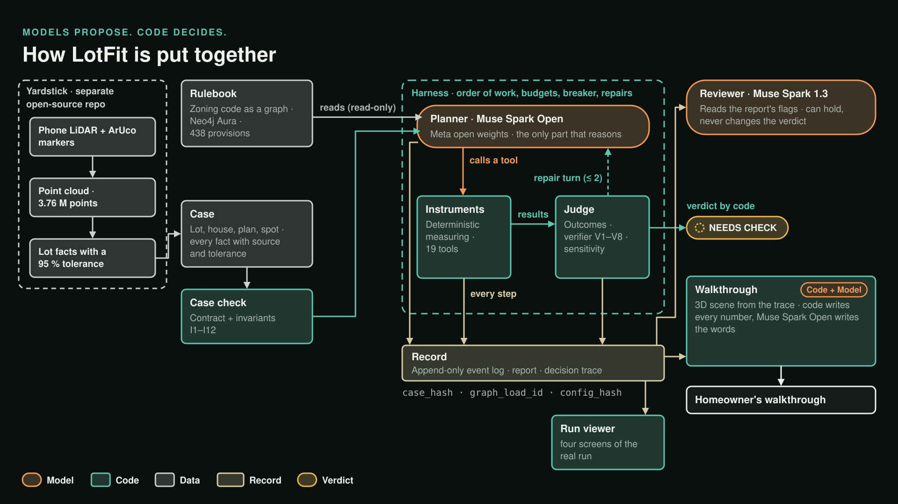
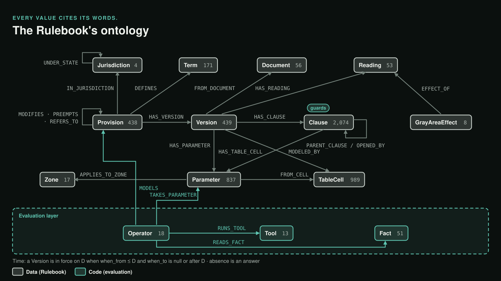
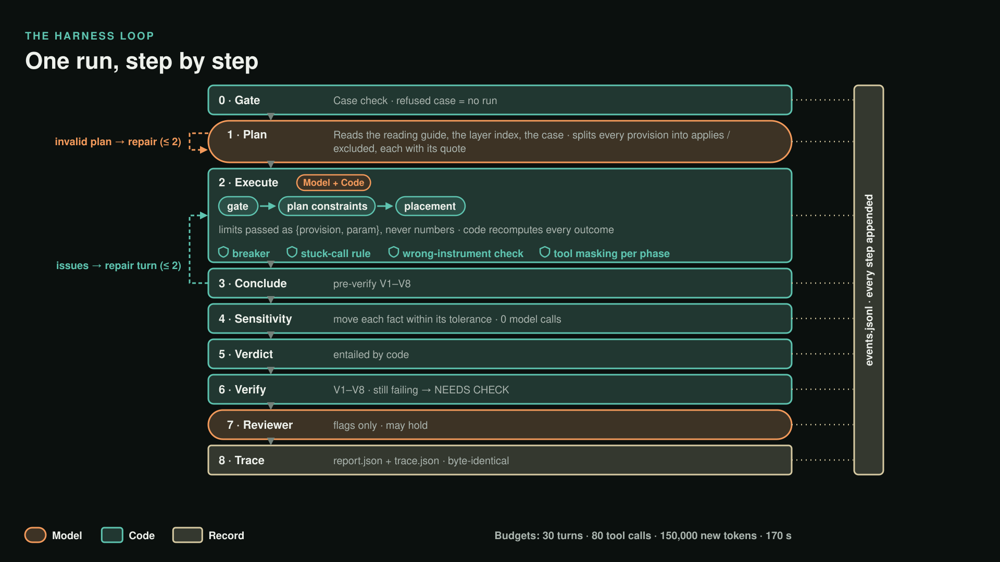
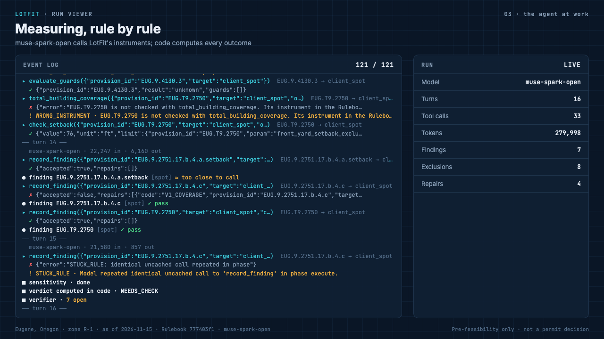
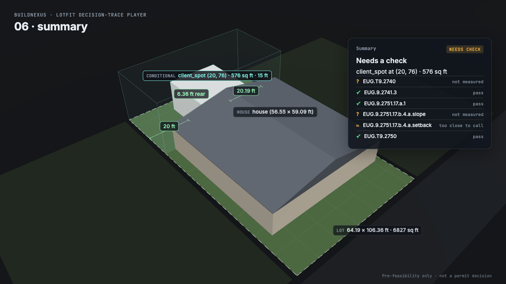

<h2 align="center">🏆 Our entry to the Meta Global AI Developer Hackathon</h2>
<p align="center"><b>Hosted by Meta · run by Cerebral Valley · inference partners Fireworks, Baseten and Modal</b><br>
Indie Developer track · build period October 27 – November 4, 2026</p>

<p align="center">
  
</p>

<p align="center">
  <b>A homeowner scans the yard with a phone. LotFit reads the city's zoning code and answers: does the backyard
  cottage fit, where, and why, with every number traced to the clause it comes from.</b>
</p>

<p align="center">
  Agent: <b>Muse Spark Open</b> (Meta open weights) · Reviewer: <b>Muse Spark</b> (Meta Model API) ·
  Code: <b>Muse Code</b> · Rulebook: <b>Neo4j Aura</b> · <b>1,120 tests passing</b>
</p>

---

> [!IMPORTANT]
> **This repository is a hackathon entry.** LotFit is our submission to the **Meta Global AI Developer Hackathon**,
> hosted by **Meta** and run by **Cerebral Valley**, with inference partners **Fireworks**, **Baseten** and
> **Modal**. Indie Developer track · build period October 27 – November 4, 2026.
>
> Everything in this repository was built during the hackathon. Yardstick, our open-source capture tool, was also
> built this week, as a separate repo.

## The problem

Oregon requires its cities of more than 2,500 people to "allow in areas … zoned for detached single-unit dwellings the
development of at least one accessory dwelling unit for each detached single-unit dwelling" (ORS 197A.425): a
backyard cottage, an ADU. Whether *your* lot allows one, and where, is spread across state statutes, a city code of hundreds of provisions, tables with footnotes, exceptions and gray
areas. Today the answer takes weeks of reading or a guess. LotFit gives a pre-feasibility answer in minutes, for
cents, and shows its work: which rules apply, what was measured, against which limit, with the verbatim words of the
law.

## What comes out

<p align="center">
  
</p>

A real run on a scanned Eugene lot with a 24×24 ft studio. Each finding is computed by code from an instrument's
result: the size cap passes (576 sq ft against 682.72 sq ft, 10 % of the lot), the front setback passes (76 ft
against 10 ft), the interior setback is **too close to call** (6.36 ft against 5 ft, inside the measurement's
tolerance), so the answer is **NEEDS CHECK: tape that dimension**, with the rules still open listed by name.

Verdicts: **FITS** · **FITS IF** (a named gray area decides it) · **NEEDS CHECK** · **NO** (no legal spot, or the use
isn't allowed) · **NOT MODELED**.

## The rule that matters

**The model never decides a fact.** Muse Spark reads, plans and calls tools; code computes every outcome and the
verdict. The agent cannot type a legal number: it passes `{provision_id, param}` and the harness resolves the value
from the graph. A margin smaller than the scan's measurement error is never called pass or fail. Anything code
cannot check stays visible as unchecked, never passing quietly. A verifier with eight checks stands between the model
and any verdict.

## Architecture

<p align="center"></p>

| Component | What it does | Code | Deep dive |
|---|---|---|---|
| **Rulebook** | The zoning code as a graph: provisions, versions, clauses with verbatim quotes, parameters, table cells, guards, exceptions, gray areas | `graph/`, `query/src/graph-*.mts` | [rulebook.md](docs/rulebook.md) |
| **Case check** | Validates the case (contract, invariants I1–I12) and computes derived facts with provenance and tolerance | `query/src/case-gate.mts`, `query/py/validate_case.py` | [harness.md](docs/harness.md#the-phases) |
| **Planner** | Muse Spark Open reads the code and the case, plans which rules apply, calls the tools | `query/src/context.mts`, `model-client.mts` | [harness.md](docs/harness.md#context-what-the-model-sees-each-turn) |
| **Instruments** | Deterministic geometry and code checks: setbacks, sizes, coverage, placements, guards, exceptions | `graph/tools/`, `graph/tool_runner.py` | [harness.md](docs/harness.md#tools-the-model-gets-22) |
| **Harness** | The loop: gate, plan, execute, conclude, repair, under budgets, with tool masking and a breaker | `query/src/harness.mts` | [harness.md](docs/harness.md) |
| **Judge** | Outcome per finding, verifier V1–V8, sensitivity to measurement tolerance, the verdict | `outcome.mts`, `verifier.mts`, `sensitivity.mts` | [harness.md](docs/harness.md#the-verifier-v1v8) |
| **Reviewer** | A second, different model reads the report's flags; it can hold a report, never change a verdict | `reviewer.mts` | [harness.md](docs/harness.md#the-phases) |
| **Record** | Append-only typed event log, hash-pinned artifacts, the decision trace | `events.mts`, `compile-trace.mts` | [record-and-traces.md](docs/record-and-traces.md) |
| **Viewer, walkthrough, narration** | A run as four screens; a 3D walkthrough driven by the trace; a voice-over where code states every number | `query/viewer/`, `query/player/`, `narration.mts` | [rendering.md](docs/rendering.md) |

## Capture: from markers to a case

The yard is walked with an iPhone (ARKit + LiDAR) around printed **ArUco markers** (`DICT_5X5_250`, 180 mm). Marker 0
sets the origin and closes the loop; close sightings check scale against the printed size. Depth frames become a
**2.5 cm voxel point cloud**; five walks merge into one lot cloud of **3,762,133 points** by 4-DOF ICP, with the back
fence agreeing within **3 mm** across walks. Every capture carries its own **95 % error** (0.42 m at 10 m), and every
site fact carries its tolerance into the case. That is what lets LotFit say *too close to call*. The scan is read
against the county record: here it found the rear line **6.26 ft deeper** than the record says.
→ [capture.md](docs/capture.md)

## The Rulebook: code as data

<p align="center"></p>

Four layers (Oregon, Portland, Gresham, Eugene): **438 provisions, 2,074 clauses, 837 parameters, 989 table cells,
349 guards, 59 exceptions**, from 56 hashed source documents. The ontology's backbone is
Provision → Version → Clause | Parameter | TableCell | Reading, plus Operators that say which Tool evaluates a rule
on which Facts. Ingest is regex and arithmetic, not a model: every quote is a substring of its source by
construction, every number cites its words or its table cell, and a five-stage gate (last run: all green) runs before
any load. The agent reads through fixed queries and a **read-only Cypher guard** (read-only, schema, arrow
direction, time bounds, `EXPLAIN`, 50-row cap) tested on 50 gold queries.
→ [rulebook.md](docs/rulebook.md)

## The Harness: the loop

<p align="center"></p>

**Gate → Plan → Execute → Conclude → Verify (+ repairs) → Sensitivity → Verdict → Reviewer → Trace.** The model's
context is rebuilt from the event log every turn: nine principles, the compact ontology, the active phase's tools,
the case, a running ledger of findings and parameters, and the last two turns. Budgets: 30 turns, 80 calls, 150,000
new tokens. Stage order, tool masking, a breaker, a stuck-call rule and a wrong-instrument check are enforced in
code. Sensitivity moves every fact within its tolerance with zero model calls, to find what would flip the verdict.
→ [harness.md](docs/harness.md)

## Record and traces: built for agents that improve

Every run writes an append-only, contract-validated event log: 193 events in the demo run, each pinned to the case
hash, the graph load and a config hash of the prompt, ontology, tool contracts and instruments' source. Every model
call logs tokens, cached and reasoning tokens, cost and time; every error carries a category (harness, model, tool,
database, case). The decision trace is byte-identical when compiled twice. Planted-error mutants, a gold query set
and repeated reliability runs measure the agent; an offline, gated loop turns failures into one patch at a time.
→ [record-and-traces.md](docs/record-and-traces.md)

## Rendering

<p align="center">
  
  
</p>

The **run viewer** replays a run in four screens: the case, the rules that apply (with quotes), the agent at work (the
real event log), and the answer. The **3D walkthrough** is a deterministic three.js scene driven only by the trace. The
**narration** splits the work: code writes every number and outcome, Muse Spark Open explains each rule in plain
words, and code checks those words before a voice reads them.
→ [rendering.md](docs/rendering.md)

## Results

| | |
|---|---|
| Tests | **1,120 checks in 35 suites, all passing** (live on Aura for the Rulebook) |
| Reliability (30 runs, 6 scenarios) | right verdict **30/30** · right reason **28/30** · clean end **27/30** · all three **26/30** · avg **$0.12** per run |
| Live runs today | Eugene 24×24: NEEDS_CHECK, 33 tool calls, **$0.40** · Eugene 16×36: NEEDS_CHECK, **$0.51** · Portland: NEEDS_CHECK, **$0.30** |
| Verifier | 7 planted-error reports, each refused with its own code; the clean report passes |
| Guard | 50/50 gold queries return their rows; every planted bad query refused |
| Determinism | trace and sensitivity byte-identical across two runs |

→ [results.md](docs/results.md)

## Models

| Role | Model | Where |
|---|---|---|
| Planner | **Muse Spark Open** (`muse-spark-open`, Meta open weights) on Fireworks | `query/src/model-client.mts` |
| Reviewer | **Muse Spark** (`muse-spark-1.3`) on the Meta Model API | `query/src/reviewer-client.mts` |
| Narration words | **Muse Spark Open**, low reasoning effort | `query/src/narration.mts` |
| Code | **Muse Code** wrote and committed the code in this repository | this repo |

## Run it

```bash
cd query && npm install
node src/test-harness.mts                       # any suite: node src/test-<name>.mts
.venv/bin/python -m pytest -q graph/tests       # instruments (from the repo root)

# a live run: keys in .env.local (FIREWORKS_API_KEY), Aura credentials in .env.aura
node src/run-live.mts eug-demo-24x24.scanline

# watch a run
python3 -m http.server -d viewer   # then open /index.html?run=demo/eug-demo-24x24
```

## Web app

A server-rendered app over the repo's own records: cases, recorded runs and the Rulebook. Sign-in is a Supabase
magic link. Screens: Cases & runs; Case (site plan, every fact with source and tolerance, edit the plan and its
spot, Check, Run); Capture (3D point cloud of the lot, the tolerance formula, scan against the record); Run
(Overview, Reading the code, The agent at work, The answer, Checks, Walkthrough); Rulebook (search the four
layers; each provision with clauses, parameters, operator, relations and its graph neighbourhood). Where
`LOTFIT_ENGINE=1`, Check case runs the engine's own `checkCase()` and Run LotFit runs `run-live.mts`, with the
event log following live. The app never re-implements a check.

```bash
cd web && pnpm install && pnpm dev   # then open http://localhost:3000
```

Environment: `NEXT_PUBLIC_SUPABASE_URL` and `NEXT_PUBLIC_SUPABASE_ANON_KEY` for sign-in; `LOTFIT_ENGINE=1` on a
machine with the engine. On Vercel the project root is `web/`.

## Repository

```
web/              the web app (Next.js): cases, capture, runs, Rulebook, magic-link sign-in
graph/            the Rulebook: curated data, the built graph (out/graph-or.json), instruments (tools/), tests
query/src/        harness, context, model client, Rulebook reader and guard, case check, judge, record, reviewer, narration
query/ontology/   the graph ontology
query/cases/      demo cases (Eugene, Portland) and the invalid cases the gate must refuse
query/eval/       gold query set, verifier mutants
query/viewer/     run viewer (with a real run)
query/player/     3D walkthrough and narration pipeline
docs/             the deep dives
```

## Hackathon entry

| | |
|---|---|
| Event | **Meta Global AI Developer Hackathon**, hosted by Meta, run by Cerebral Valley |
| Track | Indie Developer |
| Build period | October 27 – November 4, 2026 |
| Meta models used | Muse Spark Open (planner, narration) · Muse Spark 1.3 (reviewer) · Muse Code (every line of code here) |
| Inference partner used | Fireworks (Muse Spark Open); Baseten supported with `--baseten` |
| Built this week | everything in this repository; Yardstick (capture) as a separate repo |

## Team

Martin Fabbri: architecture, product and specifications. Built with Meta's Muse Code and Muse Spark models.

LotFit is a pre-feasibility tool, not a permit decision. Licensed under Apache 2.0.
