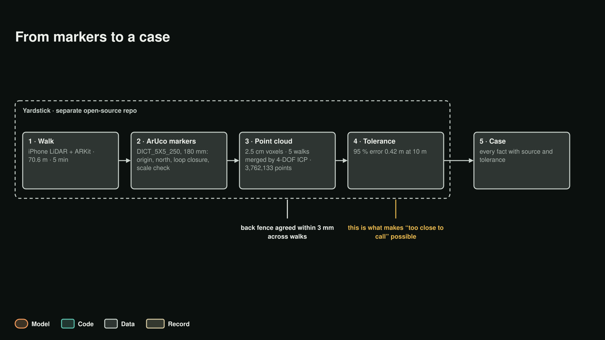

# Capture: from markers and LiDAR to a case

LotFit reads the yard from a phone scan. The scan comes from **[Yardstick](https://github.com/martin-fabbri/yardstick)**,
our open-source capture tool (Apache-2.0), built this week as a separate repository; it is not part of this hackathon
entry. LotFit accepts any capture that meets Yardstick's published `yardstick-capture/1` contract. This page explains
what the capture measures, how sure it is, and how that certainty reaches every verdict.

<p align="center"></p>

## 1. The walk

An iPhone with LiDAR runs ARKit world tracking with gravity alignment. It records colour video (1920×1440, 30 fps),
LiDAR depth on a 256×192 grid with per-pixel confidence, the camera pose of every frame, stills, compass samples for
north, and audio. Every stream is sealed with SHA-256 in the capture's manifest.

Reference walk for the demo lot: **5 min 8 s, 70.6 m walked, 9,215 depth frames, 216 keyframes, 87 marker
sightings.**

## 2. The markers

Printed **ArUco markers** (OpenCV dictionary `DICT_5X5_250`), 180 mm, on matte foam board, set around the yard.
Marker 0 is the origin and the loop-closure point: the walk starts and ends on it.

For each sighting the detector warps the candidate to a 7×7 cell grid, checks the border, reads the 5×5 bits,
refines the corners to sub-pixel, solves the pose from the four corners and the printed size, then refines it with
the LiDAR depth inside the marker. The markers anchor four things:

- **the yard frame**: origin at marker 0, +Z against gravity, ground at z = 0;
- **north**: calibrated at marker 0 (15 samples, ±10°);
- **drift**: the gap between where the walk started and ended on marker 0;
- **scale**: close sightings (0.6–2.0 m) measure each marker's printed size from the LiDAR plane. On the reference
  walk, 71 sightings measured 174.1–184.5 mm against 180 mm.

Two markers in one frame give a displacement measured without accumulated tracking; a layout solver builds a marker
graph from those pairs.

## 3. The point cloud

Depth frames (every 5th, about 6 Hz, plus keyframes) with confidence ≥ 1 and range 0.20–4.50 m are placed in the yard
frame and averaged into **2.5 cm voxels**; the ground plane is fitted with RANSAC. The reference walk alone gives
**4,088,022 points** over 122.8 m² of scanned ground.

**Five walks merged into one lot cloud of 3,762,133 points** (2 cm voxels). Walks are joined by geometry: a 4-DOF
registration (yaw about gravity plus a shift), coarse by an FFT search over plan-view structure, fine by trimmed
point-to-plane ICP. Agreement across independent walks: the back fence within **3 mm**, fence-to-fence **19.49 m**
against the county record's **19.47 m** (within 0.1 %).

## 4. How sure the scan is: the tolerance

Yardstick grades every capture with a 95 % error at range r:

```
max(tape_floor(r), 1.96 · sqrt(σ_lidar² + (scale_error · r)² + (loop_gap_per_m · r)² + σ_tracking²))
```

with σ_lidar = 0.015 m, the measured scale error (0.0156), the loop-closure gap per metre walked (1.03 m over 70.6 m)
and the tracking noise. **At 10 m: 0.42 m, 1.38 ft.** The formula and every coefficient travel inside the case
(`capture.tolerances_95pct`).

That number is why LotFit can say **too close to call**. Each site fact carries its tolerance in its provenance; an
instrument compares the margin to it; a margin smaller than the measurement error is never called pass or fail. It
becomes "tape this dimension", and the sensitivity step asks whether moving that fact within its tolerance would flip
the verdict.

## 5. Scan meets the record

The scan is placed on the county records (side fences centred on the side lot lines, the scanned rear wall on the
record's rear wall). Then each record is read against the scan:

| Reading | Record | Scan | Difference |
|---|---:|---:|---:|
| House rear wall to rear lot line | 7.59 m | 9.49 m | **+1.91 m (6.26 ft)** |
| House rear wall length | 17.13 m | 16.1 m | −1.03 m (too close to call) |
| Lot width (fence to fence) | 19.47 m | 19.49 m | +0.02 m |

The rear line disagrees by more than both tolerances together. The demo case uses the scan's rear line (106.36 ft
deep) and keeps the county value next to it as the conflicting record. Every lot line stays marked `unconfirmed`. The
house footprint comes from Oregon's statewide building footprints; the scan gives the slope (4.3 %, from 598
half-metre cells of the back yard).

## 6. Into the case

Every capture-derived fact in the case ([`query/cases/eug-demo-24x24.scanline.json`](../query/cases/eug-demo-24x24.scanline.json))
carries a provenance entry: kind `capture`, the document, where, when, the tolerance with its range and method, and
its role. The case pins the capture by `manifest_sha256`. The Case check validates it before any run, and the Harness
reads the tolerance from that provenance for every measurement.
