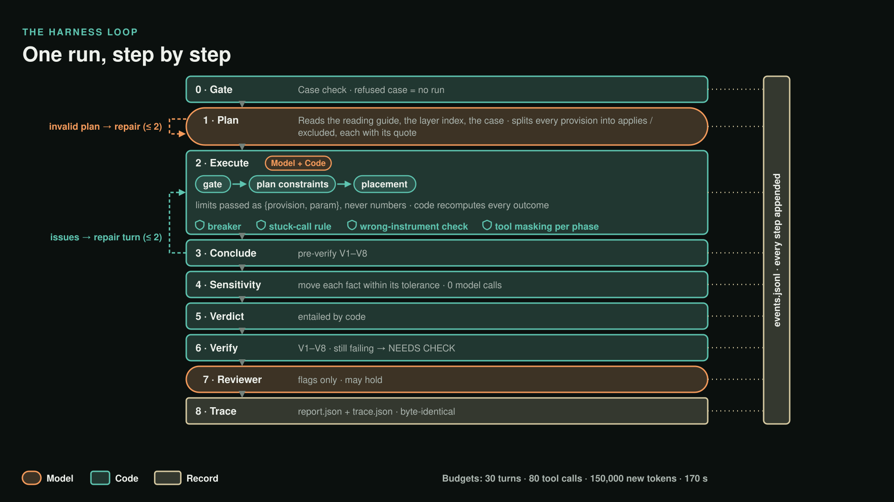

# The Harness: how one run works

The Harness is the loop that turns a case into a verdict. Muse Spark plans and calls tools; code checks every step,
computes every outcome and decides the verdict. Entry point: `evaluateDetailed(rawCase, opts)` in
[`query/src/harness.mts`](../query/src/harness.mts); one live run: `node src/run-live.mts <case>` from `query/`.

## The phases

| # | Phase | What happens | Code |
|---|---|---|---|
| 0 | **Gate** | The case is parsed against its contract and invariants I1–I12. A Python validator computes the derived facts (lot area, house rear wall, plan outline, setbacks used), each with provenance and tolerance, and the `case_hash`. A refused case never starts a run. | `case-gate.mts`, `py/validate_case.py` |
| 1 | **Plan** | Tools: `read_reading_guide`, `read_layer_index`, `inspect_case_facts`. The model returns a Plan that splits every provision in force into `applies` or `excluded_at_index`, each with a verbatim scope quote. Code validates it against the index; an invalid plan gets a repair turn with the errors. | `validatePlanAgainstIndex()` |
| 2 | **Execute** | Stage order is enforced in code: gate → plan constraint → placement constraint. Every call names a provision and a target (`case`, `client_spot`, `selected_placement`). Limits are passed as references `{provision_id, param}`, never as numbers; a bare number in a limit slot is refused. Instruments run through a Python bridge. The model records findings; **code recomputes every outcome**. | `outcome.mts`, `graph/tool_runner.py` |
| 3 | **Conclude** | `conclude` triggers a pre-verification against V1–V8; issues go back to the model as a repair turn naming each V-code. | `verifier.mts` |
| 4 | **Sensitivity** | Each fact is moved within its measurement tolerance to see whether the verdict flips. Zero model calls (a literal `model_turns: 0` in the contract). Up to 3 questions for the owner. | `sensitivity.mts` |
| 5 | **Verdict** | Entailed by code from the findings (rules below). | `entailVerdict()` |
| 6 | **Verify** | V1–V8 on the final report. Still failing after the repairs: the verdict becomes NEEDS_CHECK. | `verify()` |
| 7 | **Reviewer** | A second, different model reads the report's flags once. It can only place a hold; it never changes the verdict. Any failure is `not_run`, never a lost run. | `reviewer.mts` |
| 8 | **Trace** | `report.json`, then `trace.json`, the decision trace that drives the viewer and the 3D walkthrough. A trace that fails its own coverage check is refused and logged (`TRACE_REFUSED`). | `compile-trace.mts` |

## Control rules inside the loop

- **Phase tool masking**: each phase sees only its tools (`allowedToolsForPhase`, `context.mts`).
- **Breaker**: a failing gate or plan constraint trips it; placement tools are revoked, because nothing placed can
  save a plan the code already refuses.
- **Memo**: identical cached reads return `cached: true`.
- **Stuck rule**: an identical uncached call repeated in a phase is refused (`STUCK_RULE`).
- **No-progress rule**: three execute turns of only reads remove the read tools for the next turn.
- **Wrong instrument**: a provision checked with a tool its operator doesn't name is refused with the right
  instrument named (`WRONG_INSTRUMENT`), from the Rulebook's operator table.

## Budgets

Defaults (`DEFAULT_HARNESS_BUDGETS`, `harness.mts`): **30 turns, 80 tool calls, 150,000 new tokens, 170 s** of plan
and execute, **2 plan repairs, 2 verify repairs**. Exceeding one ends the run abnormally with verdict NEEDS_CHECK.
`run-live.mts` uses wider diagnostic budgets by default; `--strict` applies these.

## Tools the model gets: 22

| Kind | Tools |
|---|---|
| **Rulebook reads** (TypeScript) | `read_reading_guide`, `read_layer_index`, `read_rule_family` (≤ 12 provisions), `query_code_graph` (read-only Cypher through the guard), `inspect_case_facts` |
| **Instruments** (deterministic Python, `graph/tools/`) | `evaluate_guards` (three-valued), `check_allowed`, `adu_max_living_area`, `check_max`, `footprint_dimensions`, `coverage_share`, `total_building_coverage`, `placed_outline`, `physical_fit`, `distance_to_line`, `check_setback`, `check_front_or_behind`, `check_exception_conditions`, `find_placements`, `check_solar_shadow` (declared; returns a stated tool error until built) |
| **Recording** | `record_finding`, `conclude` |

The instruments' source is hashed (`impl_digest()` over `graph/tools/*.py`) into every run's config.

## Context: what the model sees each turn

The prompt is **rebuilt from the event log on every call** (`buildContextFromLog()`, `context.mts`); the model's
earlier reasoning is never re-sent.

- **System** (stable, cache-friendly): nine principles ("Models propose; code decides", "Never type a legal
  number…"), the compact ontology, and the contracts of the active phase's tools only.
- **User** (dynamic): the case facts with status (geometry by handle), the **running ledger** (agenda by stage,
  one-line findings with evidence ids, the breaker, a parameter table that survives the window), the layer index
  (plan phase), the **working window** (the last 2 turns in full), and a Next Step block.
- **Ledger compaction**: when turns leave the window, at the phase switch or on a breaker trip, the ledger the model
  saw is saved as an artifact and logged (`lotfit.ledger_compacted`).

## Outcomes: code, not the model

Each instrument returns a `MeasureResult`: value, limit, margin (negative = violation), tolerance, `pass`,
`too_close_to_call`. **Too close to call** means `|margin| < tolerance`: the measurement error of the capture could
flip it, so `pass` is null and the result names the dimension to tape. `computeFindingOutcome()` folds every result
for a provision and target into one outcome: `pass | fail | too_close_to_call | unknown | not_applicable`; only an
operator's own tools count as evidence.

## The verifier: V1–V8

| Code | Checks |
|---|---|
| V1 coverage | every provision in force not ruled out by a `known_false` guard has a finding (per target for placement rules) |
| V2 evidence | every cited call has a request and a successful result in the log |
| V3 outcome | each finding's outcome equals its cited result |
| V4 number | every number in a finding is found at its path in the cited result, sign included |
| V5 verdict | the model's proposed verdict equals the verdict code entails |
| V6 geometry | for FITS, every margin of the selected placement re-checks with margin ≥ tolerance |
| V7 parameter | every limit in a result equals the Rulebook parameter it cites |
| V8 guard | every `not_applicable` cites an `evaluate_guards` result that is `known_false` |

Each check has a planted-error mutant in [`query/eval/mutants/`](../query/eval/mutants/) that it must refuse.

## Verdicts

`FITS | FITS_IF | NEEDS_CHECK | NO_LEGS | BLOCKED_BY_GATE | NOT_MODELED`, entailed in this order: a failing gate →
BLOCKED_BY_GATE; a failing plan constraint → NO_LEGS; anything unknown or too close to call on a gate or plan
constraint → NEEDS_CHECK; a gray-area reading that decides it → FITS_IF; placement findings unknown or too close →
NEEDS_CHECK; everything passing with a passing placement → FITS. Then: a fact that flips the verdict within its
tolerance → NEEDS_CHECK; NO_LEGS only when the placement search found no candidate at all (spots that are only too
close to call give NEEDS_CHECK); an abnormal end or a failing verifier → NEEDS_CHECK. Every step writes a plain reason
into `lotfit.verdict_computed`.

## Models

| Role | Model | Provider | Code |
|---|---|---|---|
| Planner (plan and execute) | **Muse Spark Open** `muse-spark-open` (Meta open weights) | Fireworks; Baseten with `--baseten` | `model-client.mts` |
| Reviewer | **Muse Spark** `muse-spark-1.3` | Meta Model API (`--reviewer`) | `reviewer-client.mts` |
| Narration words | **Muse Spark Open**, `reasoning_effort: low` | Fireworks | `narration.mts` |

All calls: temperature 0, streamed (a long plan for a large Rulebook keeps bytes flowing), 600 s timeout, 3 retries.
Cost per call is computed from Fireworks' rates ($1.25 input, $0.15 cached, $4.25 output per million tokens) and
logged with every `messages` event.
