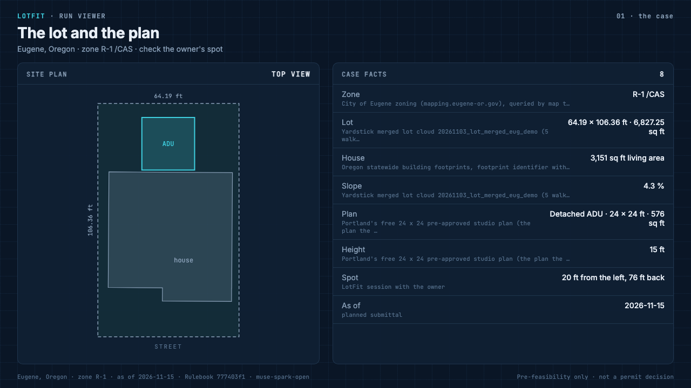
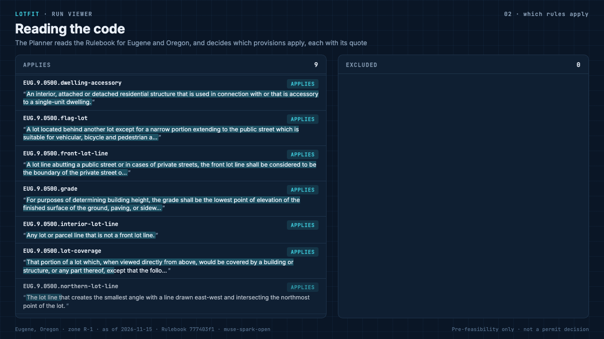
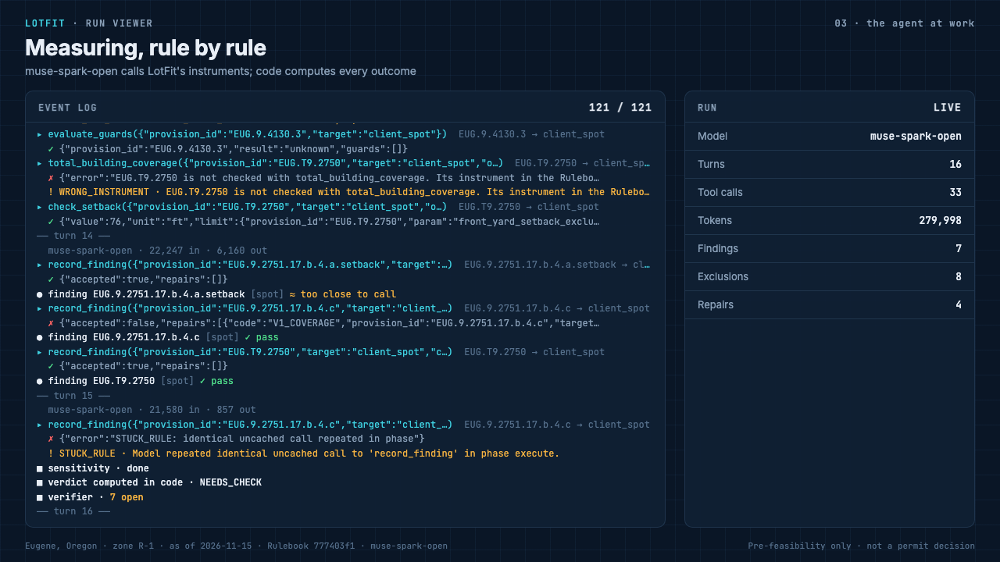
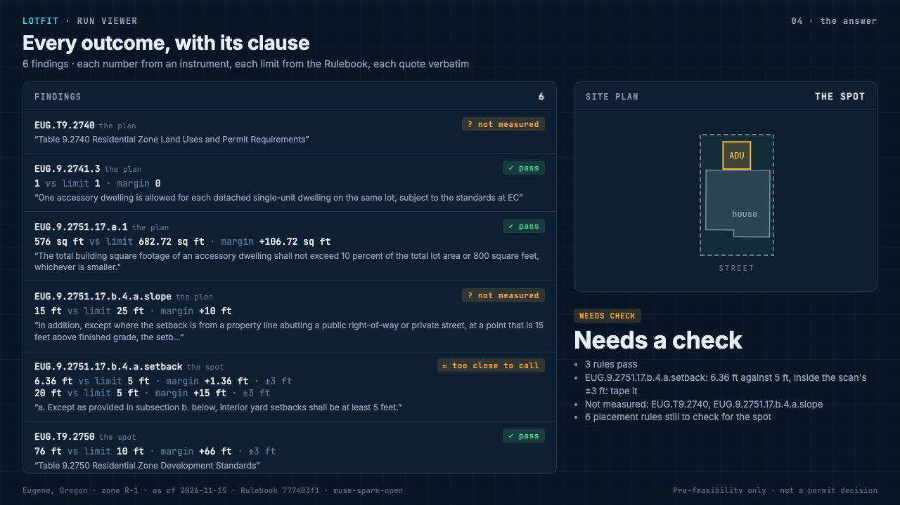
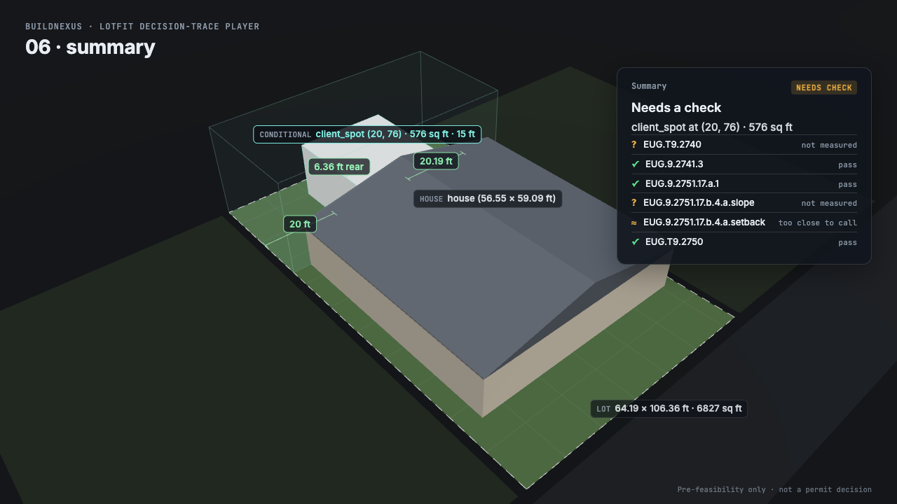
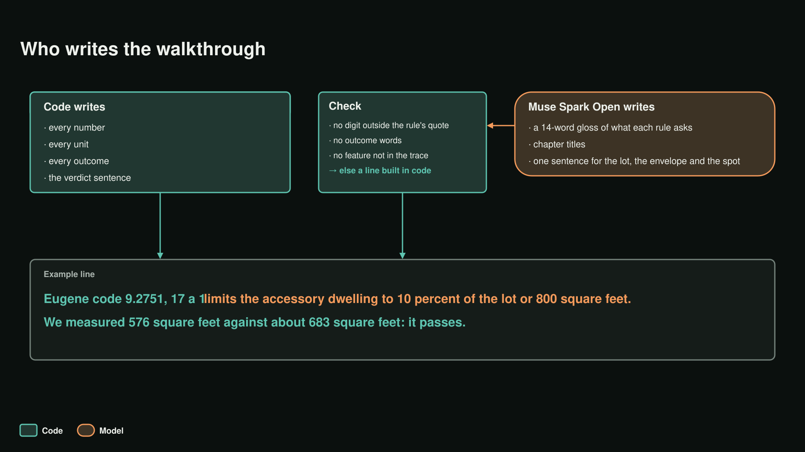

# Rendering: the viewer, the 3D walkthrough and the narration

Everything on screen is a pure function of a run's files. Nothing is drawn from memory or typed by hand: the same
run gives the same frames.

## Run viewer

[`query/viewer/`](../query/viewer/) plays one run folder (`case.json`, `case-facts.json`, `plan.json`,
`events.jsonl`, `report.json`, `trace.json`) as four screens:

| Screen | Shows |
|---|---|
|  **The case** | top-view site plan; each fact with its source (city zoning, the scan, the county, the plan) |
|  **Reading the code** | the provisions that apply and those excluded, each with its scope quote |
|  **The agent at work** | the event log replayed: turns, tool calls, results, repairs, findings, the verifier, the verdict computed in code, with running counts and model cost |
|  **The answer** | each finding with measured value, limit, margin, tolerance, outcome and quote; the spot on the plan; the verdict and why |

Open `query/viewer/index.html?run=demo/eug-demo-24x24` from any static server; `render.py` writes stills or an MP4.
`model.js` holds the pure functions (formatting, outcome and verdict wording, log, rows), tested by `test-model.mjs`
and `test-viewer-extra.mjs` (37 checks).

## 3D walkthrough player

[`query/player/`](../query/player/) is a deterministic, seekable three.js scene driven by `trace.json`: the lot, the
house, each rule as a zone, the buildable envelope, the placement options, the sun, and a summary card that states
each rule's real outcome (✓ pass, × fail, ≈ too close to call, ? not measured) under the verdict. `render.py` seeks
every frame in headless Chrome and pipes it to ffmpeg.

## Narration

[`query/src/narration.mts`](../query/src/narration.mts) writes the voice-over for a trace, one passage per beat, with
a strict split of who writes what:

- **Code writes every number and every outcome**: "Eugene code 9.2751, 17 a 1 limits the accessory dwelling to 10
  percent of the lot or 800 square feet. We measured 576 square feet against about 683 square feet: it passes."
  Spoken values are rounded in code (square feet to whole, feet to 1 decimal, "about" when rounding changed it).
- **Muse Spark Open writes only words**: a 14-word gloss of what each rule asks, chapter titles, and one sentence for
  the lot, the envelope and the spot, from the facts it is given.
- **Code checks the words**: no digit outside the rule's quote, no outcome words (pass, fail, fits, complies), no
  feature not in the trace (tree, fence, driveway…). A failing item falls back to a line built in code.

Then [`query/player/narrate/`](../query/player/narrate/): `voice.mjs` (ElevenLabs, one voice, word timestamps),
`timeline.mjs` (words with times), `mix.mjs` (one audio track), and `render.py --trace --timeline --audio` for the
final MP4. The words step takes about 45 s and a few cents; `test-narration` covers it with 25 checks.
