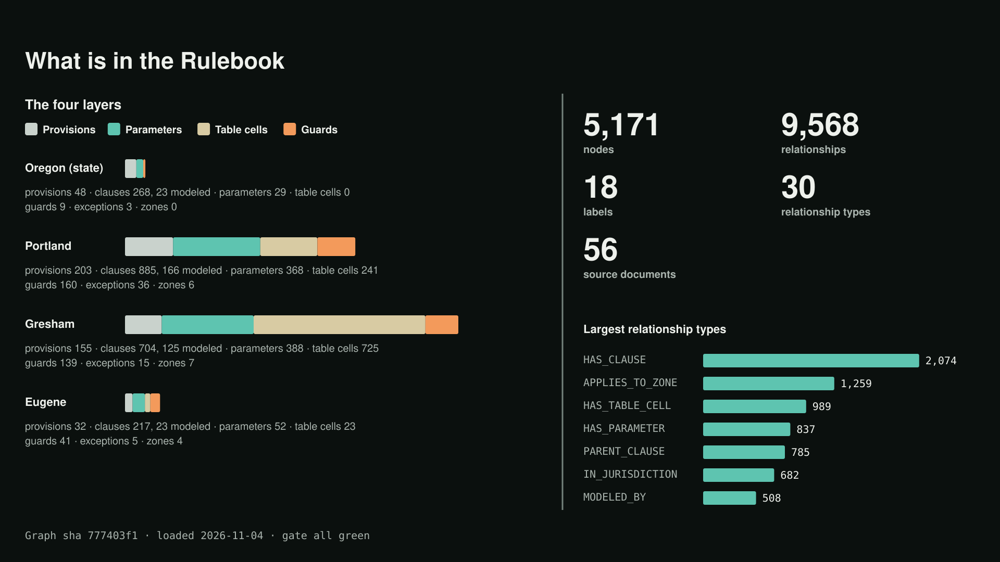
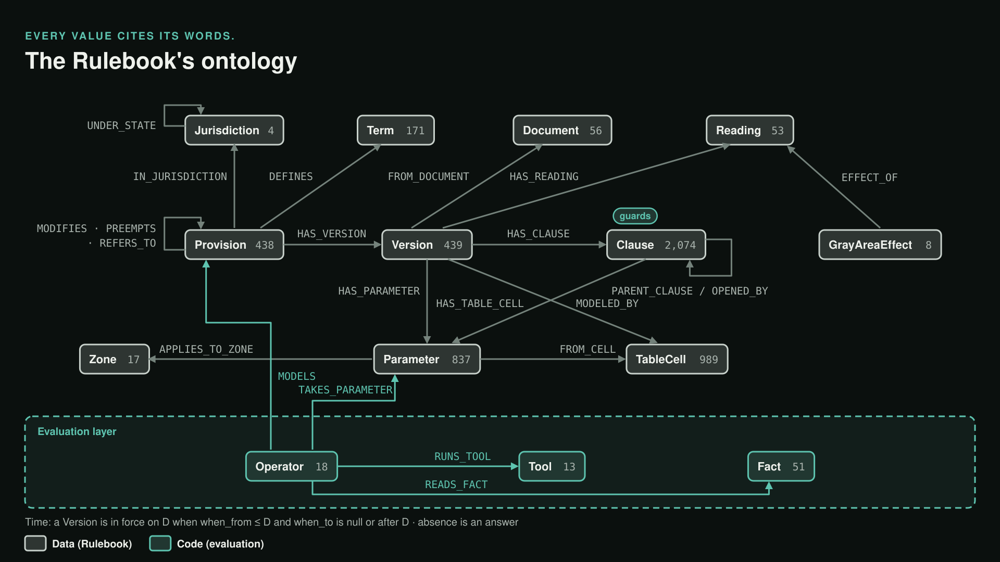

# The Rulebook: zoning code as a graph

The Rulebook holds the zoning code as data: every provision, every clause with its verbatim words, every number the
law sets, every exception and gray area. It runs on **Neo4j Aura** and ships as a file,
[`graph/out/graph-or.json`](../graph/out/graph-or.json) (schema `lotfit.codegraph/v6`, sha256
`777403f1afed002112a9225d3459f48c654dc73bbe6cfdcfd626318f9b8d542f`, loaded 2026-11-04 02:06 UTC). The same reader
interface works live on Aura or offline on the file (`graph-reads.mts`).

**The rule above all: the model never decides a fact.** Every value traces to a verbatim quote or a table cell.
Ingest is regular expressions and arithmetic, not a model.

## What is in it

**5,171 nodes in 18 labels, 9,568 relationships in 30 types**, across four layers:

| Layer | Code | Provisions | Clauses (modeled) | Parameters | Table cells | Guards | Exceptions | Zones |
|---|---|---:|---:|---:|---:|---:|---:|---:|
| OR | Oregon statutes, session laws, rules | 48 | 268 (23) | 29 | 0 | 9 | 3 | — |
| PDX | Portland Title 33 / 11 | 203 | 885 (166) | 368 | 241 | 160 | 36 | 6 |
| GRE | Gresham Community Development Code | 155 | 704 (125) | 388 | 725 | 139 | 15 | 7 |
| EUG | Eugene Code, Chapter 9 | 32 | 217 (23) | 52 | 23 | 41 | 5 | 4 |
| **All** | 56 source documents | **438** | **2,074 (337)** | **837** | **989** | **349** | **59** | **17** |

Provisions by type: 133 constraints, 118 definitions, 60 gates, 59 exceptions, 57 procedural, 11 preemptions.
Parameters: 457 cite a quote, 380 a table cell. Clauses: 337 modeled, 428 structural, 1,309 not modeled (and visible
as such, never silently passing).

## Ontology

[`query/ontology/lotfit.ontology.yaml`](../query/ontology/lotfit.ontology.yaml) (Neo4j ontology spec 1.0.0). The
backbone is **Provision → Version → Clause | Parameter | TableCell | Reading**.

| Label | Count | Meaning |
|---|---:|---|
| Clause | 2,074 | One piece of a version's text (item, sentence, condition, footnote); together they cover the text exactly |
| TableCell | 989 | One cell of a code table, verbatim, footnote markers kept |
| Parameter | 837 | A number or value the law sets, cited to its words or a cell |
| Version | 439 | The text of a provision during one period; chosen by date |
| Provision | 438 | One citable unit of law |
| Term | 171 | A defined word |
| Document | 56 | A published source, hashed |
| Reading | 53 | An ambiguous phrase and its readings, deliberately not settled |
| Fact | 51 | A site or plan fact the rules read (`site.zone`, `plan.height_ft`) |
| Operator | 18 | How the engine evaluates a kind of rule: which Tool, which Facts, which Parameters |
| Zone | 17 | A residential base zone (`PDX:R5`, `EUG:R-1`) |
| Tool | 13 | A tested function the engine runs |
| GrayAreaEffect | 8 | What a Reading changes and who can settle it |

Largest relationship types: HAS_CLAUSE 2,074 · APPLIES_TO_ZONE 1,259 · HAS_TABLE_CELL 989 · HAS_PARAMETER 837 ·
PARENT_CLAUSE 785 · IN_JURISDICTION 682 · MODELED_BY 508 · FROM_CELL 380 · ON_CELL 295.

Rules the ontology states: **time** (a Version is in force on D when `when_from ≤ D` and `when_to` is null or after
D; a missing date is returned and flagged), **evidence** (quote, page and document with every answer), **absence is an
answer**, every node carries its layer.

**Guards** are a property of a clause, derived from a keyword lexicon, never by a model ("flag lots" →
`{fact: site.flag_lot, op: true}`). A clause is ruled out only when every guard is known false; unknown facts never
rule a clause out.

## Rules as data: two real Eugene rules

**Size cap, EUG.9.2751.17.a.1**

> "The total building square footage of an accessory dwelling shall not exceed 10 percent of the total lot area or
> 800 square feet, whichever is smaller."

Two parameters, each cited to its words: `max_share_of_lot_area` = 10 %, `max_building_sqft` = 800 sq ft. Operator
`op.eug_adu_size` runs tool `adu_max_living_area` on `site.lot_area_sqft` and `plan.total_building_sqft`:
`max = min(10% × lot, 800)`, returning which one binds and the margin. On the demo lot (6,827.25 sq ft) the limit is
682.72 sq ft; the 576 sq ft plan passes by 106.72 sq ft.

**Interior setback and sloped envelope, EC 9.2751(17)(b)4.a**, stored as two provisions:

- `….setback`: "interior yard setbacks shall be at least 5 feet." Parameter `min_interior_setback` = 5 ft. Operator
  `op.eug_adu_interior_setback` requires `check_setback` on the side **and** rear lot lines. The flag-lot exception
  is a guarded clause (`site.flag_lot`).
- `….slope`: "at a point that is 15 feet above finished grade, the setback shall slope at the rate of 10 inches
  vertically for every 12 inches horizontally … not to exceed a maximum building height of 25 feet." Four
  parameters: 15 ft, 10 in, 12 in, 25 ft.

No number above is typed by anyone: the agent passes `{provision_id, param}` and the harness resolves the value from
the graph.

## Ingestion: from code text to graph

1. **Source documents**: official code text per jurisdiction (PDF or HTML and its text), each with URL, retrieval
   date and sha256. Eugene: 13 documents, edition "current through Ordinance 20742, passed July 13, 2026".
2. **Extraction** (`lotfit.code-extraction/1`): each provision's text is cut verbatim from its document's text, so
   every quote is a substring of its source by construction; parameters cite a quote or a table cell; effective dates
   come from the printed history notes.
3. **Ingest**: copies text, quotes, parameters, cells and readings verbatim; derives a parameter from a table cell
   only when the cell is a single plain quantity; finds the clause ledger by regex; turns an amending session law
   into the next version of the section it amends.
4. **Curation** ([`graph/curated/`](../graph/curated/)): what a regex shouldn't guess, each entry quoted and marked
   provisional: 51 facts, 18 operators, 19 relations, 8 gray-area effects, the conventions, the reading guide, and
   the ADU slices (Portland 42 provisions, Eugene 33).
5. **Build check**: re-derives everything and refuses a quote not in its text, a clause ledger that doesn't
   partition the text, an operator naming a missing tool, an unregistered fact, or a parameter not in its provision.
6. **Gate**: five stages that stop at the first failure (code text verbatim and hashed, no page furniture in quotes,
   every unit-bearing number accounted for, editions dated, tables uniquely keyed, independent validation, graph
   tests, local load and verify). Last run before the Aura load: all green, 0 failures.
7. **Load**: 18 uniqueness constraints and 6 indexes, `MERGE` on id for every node and edge, an in-load verify of
   every count, and the `GraphLoad` record written last. Every run records that `graph_load_id`.

## The read path and its guard

Fixed reads (`graph-tools.mts`) give the agent the reading guide, the in-force index for the state and city layers
on the case's date, and full rule families. Anything else goes through `query_code_graph`: model-written Cypher
checked by the guard ([`guard-cypher.mts`](../query/src/guard-cypher.mts)) before it runs:

1. **read-only**: refuses CREATE, MERGE, DELETE, SET, REMOVE, DROP, LOAD CSV, FOREACH and `dbms.*`/`apoc.*`/`db.*`
   calls; the session itself is opened in READ mode;
2. **schema**: unknown labels, relationships or properties are refused;
3. **direction**: an arrow against the ontology is refused with the right direction named, never auto-fixed;
4. **time**: a Version reached on a date must bound both `when_from` and `when_to`;
5. `EXPLAIN` first, then run, capped at 50 rows.

An empty result is diagnosed by code: the first pattern that matched nothing is returned with the nearest real values.

**Eval set**: [`query/eval/lotfit-eval-v0.yaml`](../query/eval/lotfit-eval-v0.yaml), 50 items × 3 phrasings
(150 questions), each with gold Cypher and expected rows. `test-guard` runs all 50 gold queries live on Aura plus
planted bad queries (write, unknown label, unknown property, inverted arrow, version without date bounds): **59/59**.
A first measurement of model-written Cypher on 13 items scored 10/13 first pass and 11/13 after one retry.
